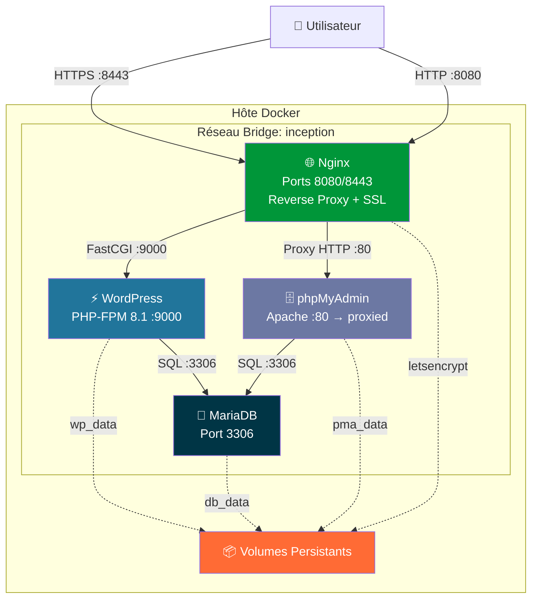

# Docker Stack - WordPress + MariaDB + phpMyAdmin + Nginx

[](https://www.docker.com/)
[](https://ubuntu.com/)
[](LICENSE)
[](https://www.conventionalcommits.org/)

> **Stack complète** pour héberger WordPress avec base de données MariaDB, interface d'administration phpMyAdmin, et reverse proxy Nginx avec SSL/TLS automatique (Let's Encrypt + fallback auto-signé).

---

## Architecture Globale



### Flux Réseau

| Service | Port Interne | Port Hôte | Protocole | Description |
|---------|-------------|-----------|-----------|-------------|
| **Nginx** | 80 / 443 | 8080 / 8443 | HTTP/HTTPS | Point d'entree unique, SSL termination |
| **WordPress** | 9000 | - | FastCGI | PHP-FPM, accessible seulement via Nginx |
| **phpMyAdmin** | 80 | - | HTTP | Proxied via Nginx sur `pma.localhost` |
| **MariaDB** | 3306 | - | MySQL | Interne uniquement, healthcheck actif |

### Volumes Partagés

| Volume | Monté Dans | Contenu |
|--------|------------|---------|
| `wp_data` | `wordpress:/var/www/wordpress`, `nginx:/var/www/wordpress` | Code WP, uploads, plugins, thèmes |
| `db_data` | `mariadb:/var/lib/mysql` | Fichiers de base de données |
| `pma_data` | `phpmyadmin:/var/www/html`, `nginx:/var/www/phpmyadmin` | Config phpMyAdmin, session |
| `letsencrypt` | `nginx:/etc/letsencrypt` | Certificats SSL Let's Encrypt |

---

## Configuration Requise

### Fichier `.env` (à la racine du projet)

```bash
# Base de données
SQL_ROOT_PASSWORD=root_secure_password
SQL_DATABASE=wordpress
SQL_USER=wp_user
SQL_PASSWORD=wp_secure_password

# WordPress
WP_URL=https://localhost:8443
WP_TITLE="Mon Site WordPress"
WP_ADMIN_LOGIN=admin
WP_ADMIN_PASSWORD=admin_secure_password
WP_ADMIN_EMAIL=admin@example.com
WP_USER_LOGIN=editor
WP_USER_EMAIL=editor@example.com
WP_USER_PASSWORD=editor_secure_password

# Nginx / SSL
DOMAIN_NAME=localhost

# phpMyAdmin
PMA_BLOWFISH_SECRET=32_chars_random_string_here
```

> **Attention : Ne commitez jamais ce fichier**. Utilisez `.env.example` comme modèle.

### Variables d'Environnement par Service

| Variable | Services | Description |
|----------|----------|-------------|
| `SQL_ROOT_PASSWORD` | mariadb, wordpress | Mot de passe root MariaDB |
| `SQL_DATABASE` | mariadb, wordpress | Nom de la base WP |
| `SQL_USER` / `SQL_PASSWORD` | mariadb, wordpress, phpmyadmin | User WP + credentials |
| `WP_URL` | wordpress | URL publique (pour liens canoniques) |
| `WP_TITLE` | wordpress | Titre du site |
| `WP_ADMIN_*` | wordpress | Compte administrateur WP |
| `WP_USER_*` | wordpress | Compte éditeur WP |
| `DOMAIN_NAME` | nginx | Domaine pour certificats SSL |
| `PMA_BLOWFISH_SECRET` | phpmyadmin | Clé de chiffrement cookies (32 chars) |

---

## Demarrage Rapide

```bash
# 1. Cloner et configurer
git clone <repo>
cd docker
cp .env.example .env
# Éditer .env avec vos valeurs sécurisées

# 2. Lancer la stack complète
docker compose up -d --build

# 3. Vérifier les logs
docker compose logs -f

# 4. Accéder aux services
# WordPress:    https://localhost:8443
# phpMyAdmin:   https://pma.localhost:8443 (ajouter dans /etc/hosts)
```

### Commandes Utiles

```bash
# Build sans cache
docker compose build --no-cache

# Voir les conteneurs
docker compose ps

# Logs d'un service
docker compose logs -f wordpress

# Shell dans un conteneur
docker compose exec wordpress bash
docker compose exec mariadb mysql -u root -p

# Arrêt propre
docker compose down

# Arret + suppression volumes (ATTENTION : PERTE DE DONNEES)
docker compose down -v

# Redémarrage d'un service
docker compose restart nginx
```

---

## Securite

### Bonnes Pratiques Implémentées

- **Non-root** : Nginx, WordPress (www-data), MariaDB (mysql), phpMyAdmin (www-data)
- **Secrets externalisés** : Via `.env` (gitignored) + GitHub Secrets en CI
- **Réseau isolé** : Bridge `inception` sans exposition directe DB/PHP-FPM
- **Healthchecks** : MariaDB (`mysqladmin ping`), dépendances conditionnelles
- **SSL/TLS** : Let's Encrypt en prod, auto-signé en dev
- **Headers sécurisés** : HSTS, X-Frame-Options, CSP via Nginx
- **Accès DB restreint** : User `wp_user`@`%` (pas root à distance)

### Durcissement Recommandé (Prod)

```yaml
# docker-compose.override.yml (exemple)
services:
  mariadb:
    read_only: true
    tmpfs: /var/lib/mysql/tmp
  nginx:
    cap_drop: [ALL]
    cap_add: [NET_BIND_SERVICE]
  wordpress:
    security_opt: [no-new-privileges:true]
```

---

## Depannage Courant

| Problème | Cause Probable | Solution |
|----------|----------------|----------|
| `wp_data` permission denied | UID/GID mismatch | `docker compose exec wordpress chown -R www-data:www-data /var/www/wordpress` |
| MariaDB healthcheck échoue | Mot de passe root incorrect | Vérifier `SQL_ROOT_PASSWORD` dans `.env` |
| Certificat SSL invalide | Pas de DNS valide pour LE | Utilise auto-signé (dev) ou configure DNS + `DOMAIN_NAME` |
| phpMyAdmin "Cannot connect" | MariaDB pas ready | Attendre healthcheck `service_healthy` |
| WP "Error establishing connection" | Credentials DB wrong | Vérifier `SQL_USER`, `SQL_PASSWORD`, `SQL_DATABASE` |

---

## Structure du Projet

```
docker/
├── README.md                 # Ce fichier
├── docker-compose.yml        # Orchestration principale
├── .env.example              # Modèle de configuration
├── mariadb/
│   ├── Dockerfile
│   ├── conf/
│   │   ├── entrypoint.sh
│   │   ├── init.sql
│   │   ├── init.sql.j2       # Template Jinja2 (Ansible)
│   │   └── 50-server.cnf
│   └── README.md
├── nginx/
│   ├── Dockerfile
│   ├── conf/
│   │   ├── nginx.conf
│   │   └── entrypoint.sh
│   └── README.md
├── phpmyadmin/
│   ├── Dockerfile
│   ├── conf/
│   │   └── config.inc.php    # Template Jinja2 (Ansible)
│   └── README.md
└── wordpress/
    ├── Dockerfile
    ├── conf/
    │   ├── www.conf
    │   └── auto_config.sh
    └── README.md
```

---

## Conventions GitHub

### Commits — [Conventional Commits](https://www.conventionalcommits.org/)

```
<type>[scope]: <description>

[body]

[footer]
```

| Type | Usage |
|------|-------|
| `feat` | Nouvelle fonctionnalité |
| `fix` | Correction de bug |
| `docs` | Documentation uniquement |
| `chore` | Maintenance, build, deps |
| `refactor` | Refactoring sans changement fonctionnel |
| `security` | Correction sécurité |
| `test` | Ajout/modification tests |

**Exemples :**
```bash
git commit -m "feat(nginx): add rate limiting for wp-login.php"
git commit -m "fix(mariadb): correct init.sql permissions for wp_user"
git commit -m "docs: add troubleshooting section to wordpress README"
```

### Branches

| Branche | Usage |
|---------|-------|
| `main` | Production (protégée, PR required) |
| `feature/*` | Nouvelles fonctionnalités |
| `fix/*` | Corrections de bugs |
| `docs/*` | Documentation uniquement |
| `chore/*` | Maintenance, CI, deps |
| `security/*` | Corrections sécurité urgentes |

### Pull Requests

- Template PR obligatoire (`.github/pull_request_template.md`)
- 1 review minimum (approbation requise)
- CI passent (lint, tests, build)
- Pas de commits `fixup!`/`squash!` dans l'historique final
- Description claire : *quoi*, *pourquoi*, *comment testé*

### Issues

Labels standardises :
- `bug` - Comportement incorrect
- `enhancement` - Amelioration / feature request
- `docs` - Documentation
- `security` - Vulnerabilite
- `good first issue` - Pour nouveaux contributeurs
- `help wanted` - Besoin d'aide communautaire

### Versioning

- **SemVer** : `MAJOR.MINOR.PATCH` (ex: `v2.1.0`)
- Tags Git annotés : `git tag -a v2.1.0 -m "Release v2.1.0"`
- Changelog maintenu dans `CHANGELOG.md` (format Keep a Changelog)

---

## References

| Service | Documentation Officielle |
|---------|--------------------------|
| Docker Compose | https://docs.docker.com/compose/ |
| Nginx | https://nginx.org/en/docs/ |
| Certbot (Let's Encrypt) | https://certbot.eff.org/ |
| WordPress (WP-CLI) | https://wp-cli.org/ |
| PHP-FPM | https://www.php.net/manual/en/install.fpm.php |
| MariaDB | https://mariadb.org/documentation/ |
| phpMyAdmin | https://docs.phpmyadmin.net/ |

---

## Licence

MIT License — Voir [LICENSE](../LICENSE) pour détails.

---

*Dernière mise à jour : 2026-11-17 — Généré selon le plan d'architecture de la stack.*