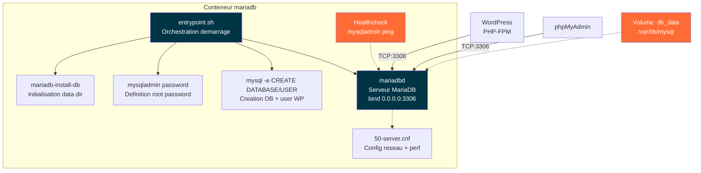
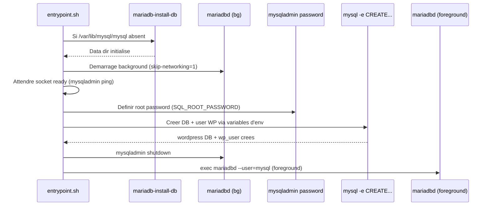

# MariaDB - Base de Donnees WordPress

[](https://mariadb.org/)
[](https://ubuntu.com/)
[](https://www.docker.com/)
[](https://hub.docker.com/_/ubuntu)

> **Conteneur MariaDB** base sur Ubuntu 22.04, configure pour WordPress avec initialisation automatique au premier demarrage, healthcheck natif, et compatibilite ARM64. L'initialisation de la base et de l'utilisateur se fait dynamiquement via les variables d'environnement dans entrypoint.sh.

---

## Architecture



### Sequence de Demarrage



---

## Configuration

### Variables d'Environnement (via `.env`)

| Variable | Defaut | Description |
|----------|--------|-------------|
| `SQL_ROOT_PASSWORD` | *requis* | Mot de passe root MariaDB |
| `SQL_DATABASE` | `wordpress` | Nom de la base WordPress |
| `SQL_USER` | `wp_user` | Utilisateur applicatif |
| `SQL_PASSWORD` | *requis* | Mot de passe utilisateur |

> Note : Les valeurs sont injectees via `docker-compose.yml` -> `env_file: .env`

### Fichiers de Configuration

| Fichier | Role | Montage |
|---------|------|---------|
| `conf/50-server.cnf` | Config serveur (bind, port, user) | `/etc/mysql/mariadb.conf.d/50-server.cnf` |
| `conf/init.sql.j2` | Template Jinja2 pour Ansible (prod) | Non monte directement |
| `conf/entrypoint.sh` | Script d'orchestration demarrage | `/usr/local/bin/entrypoint.sh` |

#### `50-server.cnf` — Points Cles

```ini
[mysqld]
bind-address    = 0.0.0.0       # Ecoute sur TOUTES les interfaces (cle Docker)
port            = 3306
datadir         = /var/lib/mysql
socket          = /var/run/mysqld/mysqld.sock
pid-file        = /var/run/mysqld/mysqld.pid
user            = mysql
skip-external-locking
```

> Note : Le fichier `init.sql` a ete supprime. La creation de la base et de l'utilisateur se fait maintenant dynamiquement dans `entrypoint.sh` en utilisant les variables d'environnement. Le template `init.sql.j2` est conserve pour un futur usage avec Ansible.

---

## Docker

### Dockerfile — Analyse

```dockerfile
FROM ubuntu:22.04                    # Base LTS, compat ARM64
ENV DEBIAN_FRONTEND=noninteractive   # Pas de prompts apt

RUN apt-get update && apt-get install -y mariadb-server \
    && apt-get clean && rm -rf /var/lib/apt/lists/*  # Nettoyage couche

COPY conf/50-server.cnf /etc/mysql/mariadb.conf.d/
COPY conf/entrypoint.sh /usr/local/bin/
RUN chmod +x /usr/local/bin/entrypoint.sh

EXPOSE 3306
ENTRYPOINT ["/usr/local/bin/entrypoint.sh"]
```

### Build & Run

```bash
# Build seul
docker build -t mariadb-wp:local ./mariadb

# Run standalone (test)
docker run -d --name mariadb-test \
  -e SQL_ROOT_PASSWORD=rootpass \
  -e SQL_DATABASE=wordpress \
  -e SQL_USER=wp_user \
  -e SQL_PASSWORD=wppass \
  -v db_data:/var/lib/mysql \
  -p 3306:3306 \
  mariadb-wp:local

# Via docker-compose (recommande)
docker compose up -d mariadb
```

---

## Integration docker-compose

```yaml
mariadb:
  container_name: mariadb
  build: ./mariadb
  env_file: .env
  volumes:
    - db_data:/var/lib/mysql
  networks:
    - inception
  expose:
    - "3306"
  restart: unless-stopped
  healthcheck:
    test: ["CMD", "mysqladmin", "ping", "-h", "localhost", "-u", "root", "-p${SQL_ROOT_PASSWORD}"]
    interval: 10s
    timeout: 5s
    retries: 5
    start_period: 30s
```

### Dependancees

- **WordPress** : `depends_on: mariadb (condition: service_healthy)`
- **phpMyAdmin** : `depends_on: mariadb (condition: service_healthy)`

### Reseau

- Reseau `inception` (bridge)
- Accessible via `mariadb:3306` depuis les autres conteneurs
- **Pas de port mapping hote** (securite : DB non exposee)

### Volume

- `db_data` -> `/var/lib/mysql` (persistant)

---

## Healthcheck

```yaml
healthcheck:
  test: ["CMD", "mysqladmin", "ping", "-h", "localhost", "-u", "root", "-p${SQL_ROOT_PASSWORD}"]
  interval: 10s
  timeout: 5s
  retries: 5
  start_period: 30s
```

- **Commande** : `mysqladmin ping` (leger, pas de connexion complete)
- **Start period** : 30s (laisse le temps a l'init DB)
- **Interval** : 10s (reactif)
- **Retries** : 5 (tolerance panne transitoire)

### Verification Manuelle

```bash
# Depuis l'hote
docker compose exec mariadb mysqladmin ping -h localhost -u root -p${SQL_ROOT_PASSWORD}

# Depuis un autre conteneur (ex: wordpress)
docker compose exec wordpress mysqladmin ping -h mariadb -u ${SQL_USER} -p${SQL_PASSWORD}
```

---

## Commandes Utiles

### Administration

```bash
# Shell root dans le conteneur
docker compose exec mariadb bash

# Client MySQL interactif (depuis hote)
docker compose exec mariadb mysql -u root -p${SQL_ROOT_PASSWORD}

# Requete unique
docker compose exec mariadb mysql -u root -p${SQL_ROOT_PASSWORD} -e "SHOW DATABASES;"

# Verifier utilisateurs
docker compose exec mariadb mysql -u root -p${SQL_ROOT_PASSWORD} -e "SELECT User, Host FROM mysql.user;"

# Status serveur
docker compose exec mariadb mysqladmin -u root -p${SQL_ROOT_PASSWORD} status
```

### Administration (depuis conteneur WordPress)

```bash
# Shell dans WordPress
docker compose exec wordpress bash

# Connexion MySQL vers MariaDB (hostname = mariadb)
mysql -h mariadb -u ${SQL_USER} -p${SQL_PASSWORD} wordpress

# Ou en root
mysql -h mariadb -u root -p${SQL_ROOT_PASSWORD} wordpress
```

#### Commandes MySQL utiles (une fois dans le client)

```sql
-- Utilisateurs WordPress
SELECT ID, user_login, user_email, user_registered FROM wp_users;

-- Voir toutes les tables
SHOW TABLES;

-- Structure d'une table
DESC wp_users;
DESC wp_posts;
DESC wp_options;

-- Articles publies
SELECT post_title, post_status FROM wp_posts WHERE post_type='post' AND post_status='publish';

-- Compter articles
SELECT COUNT(*) FROM wp_posts WHERE post_type='post';

-- Options site
SELECT option_name, option_value FROM wp_options WHERE option_name IN ('siteurl', 'home', 'blogname');

-- Affichage vertical (plus lisible)
SELECT * FROM wp_users WHERE user_login='admin'\G

-- Quitter
EXIT;
-- ou
\q
```

### Backup / Restore

```bash
# Dump complet
docker compose exec mariadb mysqldump -u root -p${SQL_ROOT_PASSWORD} --all-databases > backup_$(date +%F).sql

# Dump base WP seulement
docker compose exec mariadb mysqldump -u root -p${SQL_ROOT_PASSWORD} wordpress > wp_backup_$(date +%F).sql

# Restore
docker compose exec -T mariadb mysql -u root -p${SQL_ROOT_PASSWORD} wordpress < wp_backup_2026-01-15.sql
```

### Debug

```bash
# Logs demarrage
docker compose logs mariadb

# Suivi temps reel
docker compose logs -f mariadb

# Inspect healthcheck
docker inspect --format='{{json .State.Health}}' mariadb | jq

# Verifier config effective
docker compose exec mariadb mariadbd --verbose --help | grep -A1 '^bind-address'
```

---

## Securite

### Implemente

- User `mysql` (non-root) pour le processus `mariadbd`
- `bind-address = 0.0.0.0` + reseau Docker isole (pas d'exposition hote)
- Mots de passe via variables d'env (pas en dur dans l'image)
- `skip-external-locking` (performance conteneur)
- Healthcheck sans exposition de port
- Root password defini au demarrage via `SQL_ROOT_PASSWORD`

### Recommandations Prod

```yaml
# docker-compose.override.yml
services:
  mariadb:
    # Lecture seule root FS (sauf /var/lib/mysql, /tmp, /var/run)
    read_only: true
    tmpfs:
      - /var/lib/mysql/tmp
      - /var/run/mysqld
    # Capabilities minimales
    cap_drop: [ALL]
    cap_add: [CHOWN, DAC_OVERRIDE, SETGID, SETUID]
    # Security opts
    security_opt:
      - no-new-privileges:true
```

### Rotation des Secrets

```bash
# 1. Generer nouveau mot de passe
openssl rand -base64 32

# 2. Mettre a jour .env
# SQL_ROOT_PASSWORD=new_password
# SQL_PASSWORD=new_wp_password

# 3. Appliquer (necessite recreation conteneur pour root)
docker compose down
docker compose up -d

# 4. Mettre a jour user WP (depuis wordpress conteneur)
docker compose exec wordpress wp user update wp_user --user_pass=new_wp_password --allow-root
```

---

## Depannage

| Symptome | Cause | Solution |
|----------|-------|----------|
| `Healthcheck failed` | Mot de passe root incorrect | Verifier `SQL_ROOT_PASSWORD` dans `.env` |
| `Can't connect to MySQL server` | Conteneur pas ready | Attendre `service_healthy` (30-60s) |
| `Access denied for user 'wp_user'` | User pas cree / mauvais pwd | Verifier variables d'env `SQL_USER/PASSWORD` et logs entrypoint |
| `Table 'wp_options' doesn't exist` | WP pas installe | Verifier wordpress entrypoint, logs WP |
| `Disk full` | Volume `db_data` sature | `docker system prune -a`, augmenter disque |
| `innodb: cannot allocate memory` | RAM insuffisante | Ajouter `innodb_buffer_pool_size=128M` dans 50-server.cnf |

### Reset Complet (ATTENTION : Perte Donnees)

```bash
docker compose down -v
docker volume rm docker_db_data
docker compose up -d --build mariadb
```

---

## Structure

```
mariadb/
├── Dockerfile
├── conf/
│   ├── entrypoint.sh      # Orchestration demarrage (init DB + root pwd + WP user)
│   ├── init.sql.j2        # Template Jinja2 (Ansible prod)
│   └── 50-server.cnf      # Config serveur MariaDB
└── README.md              # Ce fichier
```

---

## Conventions GitHub

### Commits Specifiques MariaDB

```bash
# Config
git commit -m "chore(mariadb): update 50-server.cnf for innodb tuning"

# Entrypoint
git commit -m "fix(mariadb): set root password and create WP user via env vars"

# Healthcheck
git commit -m "fix(mariadb): increase healthcheck start_period to 60s"

# Securite
git commit -m "security(mariadb): drop ALL capabilities, add minimal cap_add"
```

### Labels Issues

- `database` - Tout ce qui touche MariaDB
- `performance` - Tuning, indexes, config
- `security` - Durcissement, rotation secrets

### PR Checklist MariaDB

- [ ] `init.sql.j2` mis a jour si schema change
- [ ] Healthcheck teste localement (`docker compose up mariadb`)
- [ ] Backup/restore valide
- [ ] ARM64 build teste (si modif Dockerfile)
- [ ] Variables `.env.example` synchronisees

---

## References

| Ressource | Lien |
|-----------|------|
| MariaDB Docker Official | https://hub.docker.com/_/mariadb |
| MariaDB Configuration | https://mariadb.com/kb/en/configuring-mariadb-with-mycnf/ |
| Docker Healthchecks | https://docs.docker.com/engine/reference/builder/#healthcheck |
| Ubuntu 22.04 Packages | https://packages.ubuntu.com/jammy/mariadb-server |

---

## Licence

MIT — Voir [LICENSE](../../LICENSE).

---

*Derniere mise a jour : 2026-11-17 — Partie de la stack Docker WordPress.*