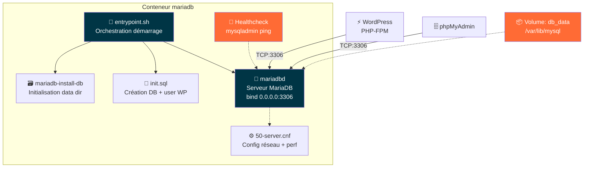
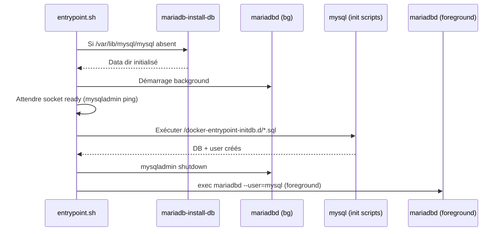

# MariaDB - Base de Donnees WordPress

[](https://mariadb.org/)
[](https://ubuntu.com/)
[](https://www.docker.com/)
[](https://hub.docker.com/_/ubuntu)

> **Conteneur MariaDB** basé sur Ubuntu 22.04, configuré pour WordPress avec initialisation automatique au premier démarrage, healthcheck natif, et compatibilité ARM64.

---

## Architecture



### Séquence de Démarrage



---

## Configuration

### Variables d'Environnement (via `.env`)

| Variable | Défaut | Description |
|----------|--------|-------------|
| `SQL_ROOT_PASSWORD` | *requis* | Mot de passe root MariaDB |
| `SQL_DATABASE` | `wordpress` | Nom de la base WordPress |
| `SQL_USER` | `wp_user` | Utilisateur applicatif |
| `SQL_PASSWORD` | *requis* | Mot de passe utilisateur |

> Note : Les valeurs sont injectees via `docker-compose.yml` -> `env_file: .env`

### Fichiers de Configuration

| Fichier | Rôle | Montage |
|---------|------|---------|
| `conf/50-server.cnf` | Config serveur (bind, port, user) | `/etc/mysql/mariadb.conf.d/50-server.cnf` |
| `conf/init.sql` | Script d'initialisation (création DB/user) | `/docker-entrypoint-initdb.d/init.sql` |
| `conf/init.sql.j2` | Template Jinja2 pour Ansible (prod) | Non monté directement |
| `conf/entrypoint.sh` | Script d'orchestration démarrage | `/usr/local/bin/entrypoint.sh` |

#### `50-server.cnf` — Points Clés

```ini
[mysqld]
bind-address    = 0.0.0.0       # Écoute sur TOUTES les interfaces (clé Docker)
port            = 3306
datadir         = /var/lib/mysql
socket          = /var/run/mysqld/mysqld.sock
pid-file        = /var/run/mysqld/mysqld.pid
user            = mysql
skip-external-locking
```

#### `init.sql` — Schema Initial

```sql
CREATE DATABASE IF NOT EXISTS `wordpress`;
CREATE USER IF NOT EXISTS 'wp_user'@'%' IDENTIFIED BY 'testpass';
CREATE USER IF NOT EXISTS 'wp_user'@'localhost' IDENTIFIED BY 'testpass';
GRANT ALL PRIVILEGES ON `wordpress`.* TO 'wp_user'@'%';
GRANT ALL PRIVILEGES ON `wordpress`.* TO 'wp_user'@'localhost';
FLUSH PRIVILEGES;
```

> Attention : En production, `init.sql.j2` est template par Ansible avec les vraies valeurs depuis Vault.

---

## Docker

### Dockerfile — Analyse

```dockerfile
FROM ubuntu:22.04                    # Base LTS, compat ARM64
ENV DEBIAN_FRONTEND=noninteractive   # Pas de prompts apt

RUN apt-get update && apt-get install -y mariadb-server \
    && apt-get clean && rm -rf /var/lib/apt/lists/*  # Nettoyage couche

COPY conf/50-server.cnf /etc/mysql/mariadb.conf.d/
COPY conf/init.sql /docker-entrypoint-initdb.d/
COPY conf/entrypoint.sh /usr/local/bin/
RUN chmod +x /usr/local/bin/entrypoint.sh

EXPOSE 3306
ENTRYPOINT ["/usr/local/bin/entrypoint.sh"]
```

### Build & Run

```bash
# Build seul
docker build -t mariadb-wp:local ./mariadb

# Run standalone (test)
docker run -d --name mariadb-test \
  -e SQL_ROOT_PASSWORD=rootpass \
  -e SQL_DATABASE=wordpress \
  -e SQL_USER=wp_user \
  -e SQL_PASSWORD=wppass \
  -v db_data:/var/lib/mysql \
  -p 3306:3306 \
  mariadb-wp:local

# Via docker-compose (recommandé)
docker compose up -d mariadb
```

---

## Integration docker-compose

```yaml
mariadb:
  container_name: mariadb
  build: ./mariadb
  env_file: .env
  volumes:
    - db_data:/var/lib/mysql
  networks:
    - inception
  expose:
    - "3306"
  restart: unless-stopped
  healthcheck:
    test: ["CMD", "mysqladmin", "ping", "-h", "localhost", "-u", "root", "-p${SQL_ROOT_PASSWORD}"]
    interval: 10s
    timeout: 5s
    retries: 5
    start_period: 30s
```

### Dépendances

- **WordPress** : `depends_on: mariadb (condition: service_healthy)`
- **phpMyAdmin** : `depends_on: mariadb (condition: service_healthy)`

### Réseau

- Réseau `inception` (bridge)
- Accessible via `mariadb:3306` depuis les autres conteneurs
- **Pas de port mapping hôte** (sécurité : DB non exposée)

### Volume

- `db_data` → `/var/lib/mysql` (persistant)

---

## Healthcheck

```yaml
healthcheck:
  test: ["CMD", "mysqladmin", "ping", "-h", "localhost", "-u", "root", "-p${SQL_ROOT_PASSWORD}"]
  interval: 10s
  timeout: 5s
  retries: 5
  start_period: 30s
```

- **Commande** : `mysqladmin ping` (léger, pas de connexion complète)
- **Start period** : 30s (laisse le temps à l'init DB)
- **Interval** : 10s (réactif)
- **Retries** : 5 (tolérance panne transitoire)

### Vérification Manuelle

```bash
# Depuis l'hôte
docker compose exec mariadb mysqladmin ping -h localhost -u root -p${SQL_ROOT_PASSWORD}

# Depuis un autre conteneur (ex: wordpress)
docker compose exec wordpress mysqladmin ping -h mariadb -u ${SQL_USER} -p${SQL_PASSWORD}
```

---

## Commandes Utiles

### Administration

```bash
# Shell root dans le conteneur
docker compose exec mariadb bash

# Client MySQL interactif
docker compose exec mariadb mysql -u root -p${SQL_ROOT_PASSWORD}

# Requête unique
docker compose exec mariadb mysql -u root -p${SQL_ROOT_PASSWORD} -e "SHOW DATABASES;"

# Vérifier utilisateurs
docker compose exec mariadb mysql -u root -p${SQL_ROOT_PASSWORD} -e "SELECT User, Host FROM mysql.user;"

# Status serveur
docker compose exec mariadb mysqladmin -u root -p${SQL_ROOT_PASSWORD} status
```

### Backup / Restore

```bash
# Dump complet
docker compose exec mariadb mysqldump -u root -p${SQL_ROOT_PASSWORD} --all-databases > backup_$(date +%F).sql

# Dump base WP seulement
docker compose exec mariadb mysqldump -u root -p${SQL_ROOT_PASSWORD} wordpress > wp_backup_$(date +%F).sql

# Restore
docker compose exec -T mariadb mysql -u root -p${SQL_ROOT_PASSWORD} wordpress < wp_backup_2026-01-15.sql
```

### Debug

```bash
# Logs démarrage
docker compose logs mariadb

# Suivi temps réel
docker compose logs -f mariadb

# Inspect healthcheck
docker inspect --format='{{json .State.Health}}' mariadb | jq

# Vérifier config effective
docker compose exec mariadb mariadbd --verbose --help | grep -A1 '^bind-address'
```

---

## Securite

### Implemente

- User `mysql` (non-root) pour le processus `mariadbd`
- `bind-address = 0.0.0.0` + reseau Docker isole (pas d'exposition hote)
- Mots de passe via variables d'env (pas en dur dans l'image)
- `skip-external-locking` (performance conteneur)
- Healthcheck sans exposition de port

### Recommandations Prod

```yaml
# docker-compose.override.yml
services:
  mariadb:
    # Lecture seule root FS (sauf /var/lib/mysql, /tmp, /var/run)
    read_only: true
    tmpfs:
      - /var/lib/mysql/tmp
      - /var/run/mysqld
    # Capabilities minimales
    cap_drop: [ALL]
    cap_add: [CHOWN, DAC_OVERRIDE, SETGID, SETUID]
    # Security opts
    security_opt:
      - no-new-privileges:true
```

### Rotation des Secrets

```bash
# 1. Générer nouveau mot de passe
openssl rand -base64 32

# 2. Mettre à jour .env
# SQL_ROOT_PASSWORD=new_password
# SQL_PASSWORD=new_wp_password

# 3. Appliquer (nécessite recréation conteneur pour root)
docker compose down
docker compose up -d

# 4. Mettre à jour user WP (depuis wordpress conteneur)
docker compose exec wordpress wp user update wp_user --user_pass=new_wp_password --allow-root
```

---

## Depannage

| Symptôme | Cause | Solution |
|----------|-------|----------|
| `Healthcheck failed` | Mot de passe root incorrect | Vérifier `SQL_ROOT_PASSWORD` dans `.env` |
| `Can't connect to MySQL server` | Conteneur pas ready | Attendre `service_healthy` (30-60s) |
| `Access denied for user 'wp_user'` | User pas créé / mauvais pwd | Vérifier `init.sql` exécuté, `SQL_USER/PASSWORD` |
| `Table 'wp_options' doesn't exist` | WP pas installé | Vérifier wordpress entrypoint, logs WP |
| `Disk full` | Volume `db_data` saturé | `docker system prune -a`, augmenter disque |
| `innodb: cannot allocate memory` | RAM insuffisante | Ajouter `innodb_buffer_pool_size=128M` dans 50-server.cnf |

### Reset Complet (ATTENTION : Perte Donnees)

```bash
docker compose down -v
docker volume rm docker_db_data
docker compose up -d --build mariadb
```

---

## Structure

```
mariadb/
├── Dockerfile
├── conf/
│   ├── entrypoint.sh      # Orchestration démarrage
│   ├── init.sql           # Script init (valeurs test)
│   ├── init.sql.j2        # Template Jinja2 (Ansible prod)
│   └── 50-server.cnf      # Config serveur MariaDB
└── README.md              # Ce fichier
```

---

## Conventions GitHub

### Commits Spécifiques MariaDB

```bash
# Config
git commit -m "chore(mariadb): update 50-server.cnf for innodb tuning"

# Init script
git commit -m "feat(mariadb): add utf8mb4 collation in init.sql.j2"

# Healthcheck
git commit -m "fix(mariadb): increase healthcheck start_period to 60s"

# Sécurité
git commit -m "security(mariadb): drop ALL capabilities, add minimal cap_add"
```

### Labels Issues

- `database` - Tout ce qui touche MariaDB
- `performance` - Tuning, indexes, config
- `security` - Durcissement, rotation secrets

### PR Checklist MariaDB

- [ ] `init.sql.j2` mis à jour si schema change
- [ ] Healthcheck testé localement (`docker compose up mariadb`)
- [ ] Backup/restore validé
- [ ] ARM64 build testé (si modif Dockerfile)
- [ ] Variables `.env.example` synchronisées

---

## References

| Ressource | Lien |
|-----------|------|
| MariaDB Docker Official | https://hub.docker.com/_/mariadb |
| MariaDB Configuration | https://mariadb.com/kb/en/configuring-mariadb-with-mycnf/ |
| Docker Healthchecks | https://docs.docker.com/engine/reference/builder/#healthcheck |
| Ubuntu 22.04 Packages | https://packages.ubuntu.com/jammy/mariadb-server |

---

## Licence

MIT — Voir [LICENSE](../../LICENSE).

---

*Dernière mise à jour : 2026-11-17 — Partie de la stack Docker WordPress.*