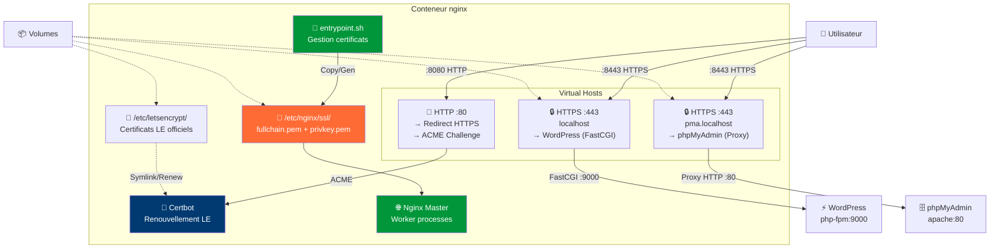
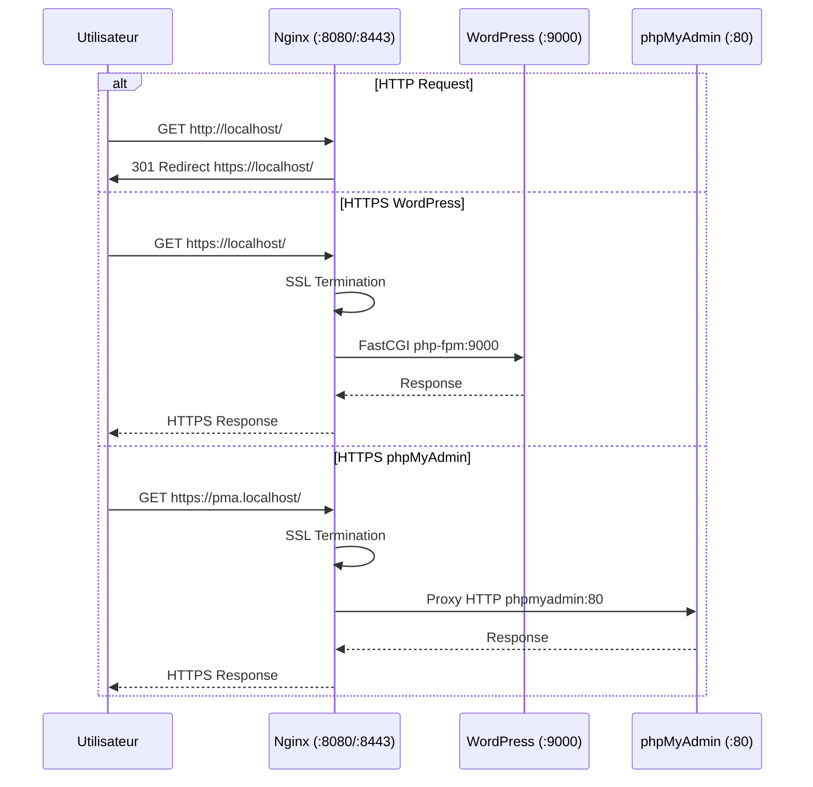

# Nginx - Reverse Proxy SSL/TLS + Certbot

[](https://nginx.org/)
[](https://certbot.eff.org/)
[](https://ubuntu.com/)
[](https://www.docker.com/)

> **Reverse Proxy Nginx** avec terminaison SSL/TLS, renouvellement automatique Let's Encrypt (Certbot), fallback certificat auto-signé, et routage vers WordPress (FastCGI) + phpMyAdmin (Proxy HTTP).

---

## Architecture



### Flux Requête



---

## Configuration

### Variables d'Environnement (via `.env`)

| Variable | Défaut | Description |
|----------|--------|-------------|
| `DOMAIN_NAME` | `localhost` | Domaine pour certificats SSL (LE + auto-signé) |

### Fichiers de Configuration

| Fichier | Rôle | Montage |
|---------|------|---------|
| `conf/nginx.conf` | Config principale Nginx (vhosts, SSL, proxy) | `/etc/nginx/nginx.conf` (read-only) |
| `conf/entrypoint.sh` | Script démarrage : certs LE → auto-signé → nginx -t → run | `/usr/local/bin/entrypoint.sh` |

#### `nginx.conf` — Structure

```nginx
events {
    worker_connections 1024;
}

http {
    # Gzip, logs, mime types...
    
    # 1. HTTP → HTTPS Redirect + ACME Challenge
    server {
        listen 80;
        server_name localhost pma.localhost;
        
        location /.well-known/acme-challenge/ {
            root /var/www/certbot;  # Certbot webroot
        }
        location / {
            return 301 https://$server_name$request_uri;
        }
    }
    
    # 2. WordPress HTTPS (FastCGI)
    server {
        listen 443 ssl http2;
        server_name localhost;
        
        ssl_certificate /etc/nginx/ssl/fullchain.pem;
        ssl_certificate_key /etc/nginx/ssl/privkey.pem;
        
        root /var/www/wordpress;
        index index.php;
        
        location / {
            try_files $uri $uri/ /index.php?$args;
        }
        
        location ~ \.php$ {
            fastcgi_pass wordpress:9000;  # ← Service Docker
            include fastcgi_params;
            fastcgi_param SCRIPT_FILENAME $document_root$fastcgi_script_name;
            fastcgi_param HTTPS on;
        }
        
        # Sécurité: deny dotfiles, uploads PHP
    }
    
    # 3. phpMyAdmin HTTPS (Proxy HTTP)
    server {
        listen 443 ssl http2;
        server_name pma.localhost;
        
        ssl_certificate /etc/nginx/ssl/fullchain.pem;
        ssl_certificate_key /etc/nginx/ssl/privkey.pem;
        
        root /var/www/phpmyadmin;
        
        location / {
            proxy_pass http://phpmyadmin:80;  # ← Service Docker
            proxy_set_header Host $host;
            proxy_set_header X-Real-IP $remote_addr;
            proxy_set_header X-Forwarded-For $proxy_add_x_forwarded_for;
            proxy_set_header X-Forwarded-Proto $scheme;
            # ... autres headers
        }
        
        # Sécurité: deny libraries, setup, templates
    }
}
```

#### `entrypoint.sh` — Logique Certificats

```bash
#!/bin/bash
set -e

DOMAIN_NAME="${DOMAIN_NAME:-localhost}"

# 1. Si certificats Let's Encrypt existent → les utiliser
if [ -f "/etc/letsencrypt/live/$DOMAIN_NAME/fullchain.pem" ]; then
    cp /etc/letsencrypt/live/$DOMAIN_NAME/fullchain.pem /etc/nginx/ssl/fullchain.pem
    cp /etc/letsencrypt/live/$DOMAIN_NAME/privkey.pem /etc/nginx/ssl/privkey.pem
fi

# 2. Sinon générer auto-signé (dev / premier démarrage)
if [ ! -f "/etc/nginx/ssl/fullchain.pem" ]; then
    openssl req -x509 -nodes -newkey rsa:2048 -days 365 \
        -keyout /etc/nginx/ssl/privkey.pem \
        -out /etc/nginx/ssl/fullchain.pem \
        -subj "/CN=$DOMAIN_NAME" \
        -addext "subjectAltName=DNS:$DOMAIN_NAME,DNS:pma.$DOMAIN_NAME"
fi

# 3. Valider config
nginx -t

# 4. Démarrer nginx foreground
exec nginx -g "daemon off;"
```

---

## Docker

### Dockerfile — Analyse

```dockerfile
FROM ubuntu:22.04

ENV DEBIAN_FRONTEND=noninteractive

# Install nginx + certbot + plugin nginx
RUN apt-get update -y && apt-get upgrade -y \
    && apt-get install -y nginx certbot python3-certbot-nginx \
    && apt-get clean && rm -rf /var/lib/apt/lists/*

# Config nginx (templatée par Ansible en prod)
COPY conf/nginx.conf /etc/nginx/nginx.conf

# Dossiers SSL + web roots
RUN mkdir -p /etc/nginx/ssl /var/www/wordpress /var/www/phpmyadmin /var/www/certbot

# Entrypoint gestion certificats
COPY conf/entrypoint.sh /usr/local/bin/
RUN chmod +x /usr/local/bin/entrypoint.sh

EXPOSE 80 443
ENTRYPOINT ["/usr/local/bin/entrypoint.sh"]
```

### Build & Run

```bash
# Build seul
docker build -t nginx-wp:local ./nginx

# Run standalone (test avec cert auto-signé)
docker run -d --name nginx-test \
  -e DOMAIN_NAME=localhost \
  -v wp_data:/var/www/wordpress \
  -v pma_data:/var/www/phpmyadmin \
  -v letsencrypt:/etc/letsencrypt \
  -p 8080:80 -p 8443:443 \
  nginx-wp:local

# Via docker-compose (recommandé)
docker compose up -d nginx
```

---

## Integration docker-compose

```yaml
nginx:
  container_name: nginx
  build: ./nginx
  env_file: .env
  volumes:
    - wp_data:/var/www/wordpress          # Code WP (partagé wordpress)
    - pma_data:/var/www/phpmyadmin        # phpMyAdmin (partagé phpmyadmin)
    - ./nginx/conf:/etc/nginx/conf.d:ro   # Config Nginx (read-only)
    - letsencrypt:/etc/letsencrypt        # Certificats LE persistants
  networks:
    - inception
  ports:
    - "8080:80"      # HTTP → Redirect
    - "8443:443"     # HTTPS → Termination SSL
  depends_on:
    - wordpress
    - phpmyadmin
  restart: unless-stopped
```

### Dépendances

- **WordPress** : Doit être up pour FastCGI (pas de healthcheck strict, mais `depends_on`)
- **phpMyAdmin** : Doit être up pour proxy HTTP

### Réseau

- Réseau `inception` (bridge)
- Résolution DNS Docker : `wordpress:9000`, `phpmyadmin:80`

### Ports Hôte

| Port Hôte | Port Conteneur | Usage |
|-----------|----------------|-------|
| 8080 | 80 | HTTP → Redirect 301 vers HTTPS |
| 8443 | 443 | HTTPS (SSL Termination) |

> Note : En prod derriere un LB/cloud, mappez 80/443 directement.

### Volumes

| Volume | Contenu | Partagé Avec |
|--------|---------|--------------|
| `wp_data` | `/var/www/wordpress` (code, uploads) | `wordpress` |
| `pma_data` | `/var/www/phpmyadmin` | `phpmyadmin` |
| `letsencrypt` | `/etc/letsencrypt` (certificats LE) | — |
| `./nginx/conf` | `/etc/nginx/conf.d` (read-only) | — |

---

## Gestion Certificats SSL

### Mode Développement (Auto-signé)

- Au premier démarrage sans certs LE → génère auto-signé RSA 2048 bits, 365 jours
- SAN inclus : `localhost`, `pma.localhost`
- Navigateur affichera avertissement → "Accepter le risque"

### Mode Production (Let's Encrypt)

#### Prérequis

- Domaine public valide (ex: `monsite.com`, `pma.monsite.com`)
- DNS A/AAAA → IP publique du serveur
- Ports 80/443 accessibles depuis Internet

#### Obtention Initiale

```bash
# 1. Configurer DOMAIN_NAME dans .env
DOMAIN_NAME=monsite.com

# 2. Démarrer nginx (avec cert auto-signé temporaire)
docker compose up -d nginx

# 3. Demander certificat LE (webroot mode)
docker compose exec nginx certbot certonly --webroot \
  -w /var/www/certbot \
  -d monsite.com -d pma.monsite.com \
  --email admin@monsite.com --agree-tos --no-eff-email

# 4. Les certs sont dans /etc/letsencrypt/live/monsite.com/
# 5. Redémarrer nginx pour les prendre en compte
docker compose restart nginx
```

#### Renouvellement Automatique

```bash
# Test renewal (dry-run)
docker compose exec nginx certbot renew --dry-run

# Renouvellement manuel
docker compose exec nginx certbot renew --webroot -w /var/www/certbot

# Cron recommandé (hôte) : 0 3 * * * docker compose exec nginx certbot renew --quiet --webroot -w /var/www/certbot && docker compose restart nginx
```

> Attention : Le renouvellement necessite que le conteneur nginx tourne et que le challenge ACME passe sur le port 80.

### Vérification Certificats

```bash
# Voir certificat actif
docker compose exec nginx openssl x509 -in /etc/nginx/ssl/fullchain.pem -text -noout

# Vérifier dates
docker compose exec nginx openssl x509 -in /etc/nginx/ssl/fullchain.pem -dates -noout

# Test SSL depuis l'extérieur
openssl s_client -connect localhost:8443 -servername localhost </dev/null
```

---

## Commandes Utiles

### Administration

```bash
# Shell dans le conteneur
docker compose exec nginx bash

# Test config nginx
docker compose exec nginx nginx -t

# Recharger config (sans downtime)
docker compose exec nginx nginx -s reload

# Voir processus
docker compose exec nginx ps aux

# Accéder aux logs
docker compose exec nginx tail -f /var/log/nginx/access.log
docker compose exec nginx tail -f /var/log/nginx/error.log
docker compose exec nginx tail -f /var/log/nginx/wordpress_access.log
```

### Certificats

```bash
# Lister certs LE
docker compose exec nginx certbot certificates

# Voir cert auto-signé
docker compose exec nginx openssl x509 -in /etc/nginx/ssl/fullchain.pem -text -noout

# Forcer renouvellement
docker compose exec nginx certbot renew --force-renewal --webroot -w /var/www/certbot
```

### Debug

```bash
# Logs démarrage
docker compose logs nginx

# Suivi temps réel
docker compose logs -f nginx

# Test connectivité backend
docker compose exec nginx curl -f http://wordpress:9000  # FastCGI ne répond pas en HTTP
docker compose exec nginx curl -f http://phpmyadmin:80   # Doit répondre

# Vérifier résolution DNS interne
docker compose exec nginx getent hosts wordpress
docker compose exec nginx getent hosts phpmyadmin
```

---

## Securite

### Implemente

- **SSL/TLS** : TLS 1.2/1.3 uniquement, ciphers HIGH
- **HSTS** : Recommande d'ajouter `add_header Strict-Transport-Security "max-age=31536000";` dans vhosts HTTPS
- **Headers securises** : `X-Frame-Options`, `X-Content-Type-Options` (a ajouter)
- **ACME Challenge** : Isole sur `/var/www/certbot`
- **Deny dotfiles** : `location ~ /\. { deny all; }`
- **Deny PHP uploads** : `location ~* /(?:uploads|files)/.*\.php$ { deny all; }`
- **Deny phpMyAdmin sensibles** : `libraries/`, `setup/`, `templates/`
- **Read-only config mount** : `:ro` sur `./nginx/conf`
- **Non-root** : Nginx master en root (bind ports 80/443), workers en `www-data`

### Recommandations Prod

```nginx
# À ajouter dans chaque server HTTPS block
add_header Strict-Transport-Security "max-age=31536000; includeSubDomains" always;
add_header X-Frame-Options "SAMEORIGIN" always;
add_header X-Content-Type-Options "nosniff" always;
add_header Referrer-Policy "strict-origin-when-cross-origin" always;
add_header Content-Security-Policy "default-src 'self'; script-src 'self' 'unsafe-inline'; style-src 'self' 'unsafe-inline';" always;

# Rate limiting (exemple)
limit_req_zone $binary_remote_addr zone=wp_login:10m rate=5r/s;
location ~ wp-login\.php {
    limit_req zone=wp_login burst=3 nodelay;
    # ... fastcgi config
}
```

### Durcissement Conteneur

```yaml
# docker-compose.override.yml
services:
  nginx:
    cap_drop: [ALL]
    cap_add: [NET_BIND_SERVICE, DAC_OVERRIDE, CHOWN]
    read_only: true
    tmpfs:
      - /var/cache/nginx
      - /var/run
      - /tmp
    security_opt:
      - no-new-privileges:true
```

---

## Depannage

| Symptôme | Cause | Solution |
|----------|-------|----------|
| `502 Bad Gateway` WordPress | php-fpm pas ready / port 9000 | Vérifier `wordpress` up, `docker compose logs wordpress` |
| `502 Bad Gateway` phpMyAdmin | Apache pas ready / port 80 | Vérifier `phpmyadmin` up, logs |
| `SSL certificate problem` | Cert auto-signé / domaine mismatch | Accepter dans navigateur, ou configurer LE valide |
| `certbot: challenge failed` | Port 80 bloqué / DNS pas propagé | Vérifier firewall, DNS, attendre propagation |
| `nginx: [emerg] host not found` | Dépendance pas démarrée | `depends_on` + healthcheck sur wordpress/phpmyadmin |
| `Permission denied /var/www/certbot` | Volume rights | `chown -R www-data:www-data /var/www/certbot` |
| `Config test failed` | Syntax error nginx.conf | `docker compose exec nginx nginx -t` pour détails |

### Reset SSL (Dev)

```bash
# Supprimer certs et régénérer auto-signé
docker compose exec nginx rm -f /etc/nginx/ssl/fullchain.pem /etc/nginx/ssl/privkey.pem
docker compose restart nginx
```

---

## Structure

```
nginx/
├── Dockerfile
├── conf/
│   ├── nginx.conf       # Config principale (vhosts, SSL, proxy)
│   └── entrypoint.sh    # Gestion certificats + démarrage
└── README.md            # Ce fichier
```

---

## Conventions GitHub

### Commits Spécifiques Nginx

```bash
# Config vhost
git commit -m "feat(nginx): add rate limiting for wp-login.php"

# SSL/Certbot
git commit -m "fix(nginx): correct certbot webroot path in entrypoint.sh"

# Sécurité headers
git commit -m "security(nginx): add HSTS, CSP, X-Frame-Options headers"

# Performance
git commit -m "perf(nginx): enable gzip_static, tune worker_connections"
```

### Labels Issues

- `proxy` - Reverse proxy, routing, upstream
- `ssl` - Certificats, TLS, Let's Encrypt
- `security` - Headers, hardening, vulnerabilities
- `performance` - Caching, compression, worker tuning

### PR Checklist Nginx

- [ ] `nginx -t` passe sans erreur
- [ ] Test HTTP→HTTPS redirect fonctionne
- [ ] Test ACME challenge (certbot) passe
- [ ] FastCGI WordPress répond (page d'accueil)
- [ ] Proxy phpMyAdmin répond (login page)
- [ ] Headers sécurité présents (`curl -I https://localhost:8443`)
- [ ] Config read-only mount respectée

---

## References

| Ressource | Lien |
|-----------|------|
| Nginx Documentation | https://nginx.org/en/docs/ |
| Nginx SSL/TLS | https://nginx.org/en/docs/http/configuring_https_servers.html |
| Certbot Nginx Plugin | https://certbot.eff.org/docs/using.html#nginx |
| Let's Encrypt Docs | https://letsencrypt.org/docs/ |
| Mozilla SSL Config Generator | https://ssl-config.mozilla.org/ |
| OWASP Secure Headers | https://owasp.org/www-project-secure-headers/ |

---

## Licence

MIT — Voir [LICENSE](../../LICENSE).

---

*Dernière mise à jour : 2026-11-17 — Partie de la stack Docker WordPress.*