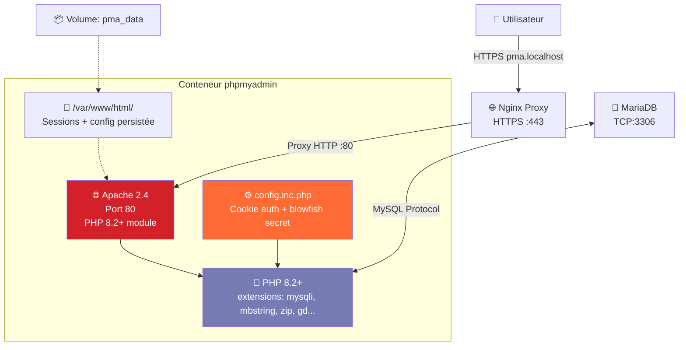
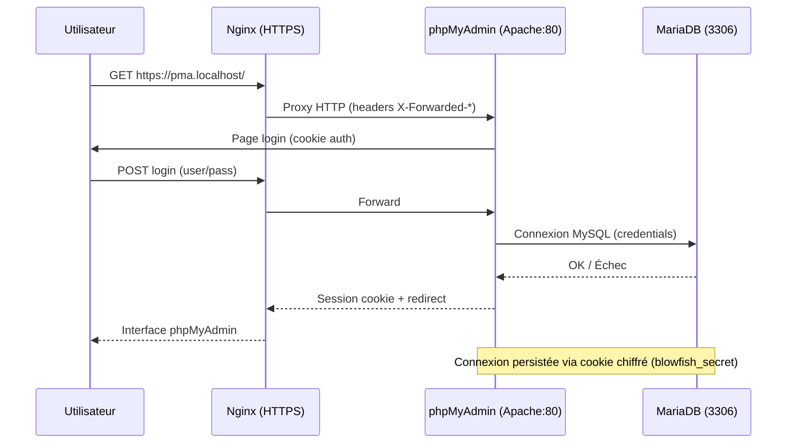

# phpMyAdmin - Interface d'Administration MariaDB

[](https://www.phpmyadmin.net/)
[](https://hub.docker.com/r/phpmyadmin/phpmyadmin)
[](https://hub.docker.com/r/phpmyadmin/phpmyadmin)
[](https://httpd.apache.org/)

> **Image officielle phpMyAdmin** (multi-arch ARM64/AMD64) avec configuration custom via `config.inc.php` templaté par Ansible. Accessible via Nginx reverse proxy sur `https://pma.localhost:8443`.

---

## Architecture



### Flux Connexion



---

## Configuration

### Variables d'Environnement (via `.env` + templating Ansible)

| Variable | Source | Description |
|----------|--------|-------------|
| `SQL_USER` | `.env` | Utilisateur MariaDB (ex: `wp_user`) |
| `SQL_PASSWORD` | `.env` | Mot de passe utilisateur |
| `PMA_BLOWFISH_SECRET` | `.env` | Clé 32 chars pour chiffrement cookies |

> **Attention : Le fichier `config.inc.php` contient des templates Jinja2** (`{{ sql_user }}`, `{{ pma_blowfish_secret }}`). En production, Ansible rend le fichier final. En dev local, le fichier `config.inc.php` est utilise tel quel avec valeurs test.

### Fichier de Configuration

| Fichier | Rôle | Montage |
|---------|------|---------|
| `conf/config.inc.php` | Config phpMyAdmin (servers, auth, blowfish) | `/etc/phpmyadmin/config.inc.php` |

#### `config.inc.php` — Analyse

```php
<?php
// Clé de chiffrement des cookies (32 caractères requis)
$cfg['blowfish_secret'] = '{{ pma_blowfish_secret }}';

// Configuration serveur MariaDB
$cfg['Servers'][1]['host'] = 'mariadb';        // Nom service Docker
$cfg['Servers'][1]['port'] = '3306';
$cfg['Servers'][1]['auth_type'] = 'cookie';    // Auth par formulaire + cookie
$cfg['Servers'][1]['user'] = '{{ sql_user }}';     // Injecté par Ansible/.env
$cfg['Servers'][1]['password'] = '{{ sql_password }}'; // Injecté par Ansible/.env

// Pas de dossier upload/save (sécurité)
$cfg['UploadDir'] = '';
$cfg['SaveDir'] = '';
```

### Points Clés

| Paramètre | Valeur | Raison |
|-----------|--------|--------|
| `host` | `mariadb` | DNS Docker interne |
| `auth_type` | `cookie` | Formulaire login, pas de credentials en URL |
| `blowfish_secret` | 32 chars aléatoires | Chiffrement cookies session (obligatoire) |
| `UploadDir/SaveDir` | `''` | Désactivé (sécurité) |

---

## Docker

### Dockerfile — Analyse

```dockerfile
###########################################################
# phpMyAdmin - Image officielle (multi-arch Arm64 OK)
###########################################################
FROM phpmyadmin/phpmyadmin:latest

# Config custom (sera templatée par Ansible)
COPY conf/config.inc.php /etc/phpmyadmin/config.inc.php
```

**C'est tout !** L'image officielle gère :
- Apache + PHP + extensions requises
- Entrypoint natif (apache2-foreground)
- Healthcheck natif
- Multi-arch (amd64, arm64, ppc64le, s390x)

### Build & Run

```bash
# Build (trivial, juste copy config)
docker build -t phpmyadmin-wp:local ./phpmyadmin

# Run standalone (test)
docker run -d --name pma-test \
  -e PMA_HOST=mariadb \
  -e PMA_USER=wp_user \
  -e PMA_PASSWORD=wppass \
  -p 8080:80 \
  phpmyadmin-wp:local

# Via docker-compose (recommandé)
docker compose up -d phpmyadmin
```

> Note : L'image officielle accepte aussi des variables d'env directes (`PMA_HOST`, `PMA_USER`, etc.) mais nous utilisons `config.inc.php` pour controle total.

---

## Integration docker-compose

```yaml
phpmyadmin:
  container_name: phpmyadmin
  build: ./phpmyadmin
  env_file: .env
  volumes:
    - pma_data:/var/www/html
  networks:
    - inception
  expose:
    - "9000"          # Port par défaut image (non utilisé, Apache sur 80)
  depends_on:
    mariadb:
      condition: service_healthy
  restart: unless-stopped
```

### Dépendances

- **MariaDB** : `depends_on: mariadb (condition: service_healthy)` — phpMyAdmin ne démarre que si DB prête

### Réseau

- Réseau `inception` (bridge)
- Accessible via `mariadb:3306` (MySQL protocol)
- **Port 80 (Apache) non exposé sur l'hôte** — uniquement via Nginx proxy

### Ports

| Port | Usage | Exposé Hôte |
|------|-------|-------------|
| 80 | Apache HTTP (interne) | Non (via Nginx) |
| 9000 | Défaut image (inutilisé) | Non |

> Attention : L'`expose: "9000"` dans docker-compose.yml est un vestige (port par defaut image), Apache ecoute sur 80.

### Volume

- `pma_data` → `/var/www/html` (persistance sessions, config utilisateur)

---

## Acces via Nginx

### Configuration Nginx (extrait)

```nginx
# phpMyAdmin HTTPS (proxy vers Apache sur port 80)
server {
    listen 443 ssl http2;
    server_name pma.localhost;
    
    ssl_certificate /etc/nginx/ssl/fullchain.pem;
    ssl_certificate_key /etc/nginx/ssl/privkey.pem;
    
    root /var/www/phpmyadmin;
    index index.php;
    
    location / {
        proxy_pass http://phpmyadmin:80;
        proxy_set_header Host $host;
        proxy_set_header X-Real-IP $remote_addr;
        proxy_set_header X-Forwarded-For $proxy_add_x_forwarded_for;
        proxy_set_header X-Forwarded-Proto $scheme;
        proxy_set_header X-Forwarded-Host $host;
        proxy_set_header X-Forwarded-Port $server_port;
    }
    
    # Sécurité
    location ~ /\. { deny all; }
    location ~ /(libraries|setup|templates)/ { deny all; }
}
```

### Accès Local

1. Ajouter dans `/etc/hosts` :
   ```
   127.0.0.1 pma.localhost
   ```

2. Accéder : `https://pma.localhost:8443`

3. Login avec :
   - **Serveur** : `mariadb` (pré-rempli)
   - **Utilisateur** : `wp_user` (depuis `SQL_USER`)
   - **Mot de passe** : `SQL_PASSWORD`

---

## Commandes Utiles

### Administration

```bash
# Shell dans le conteneur
docker compose exec phpmyadmin bash

# Logs Apache
docker compose exec phpmyadmin tail -f /var/log/apache2/access.log
docker compose exec phpmyadmin tail -f /var/log/apache2/error.log

# Vérifier config PHP
docker compose exec phpmyadmin php -m | grep -E 'mysqli|mbstring|gd|zip'

# Test connexion MariaDB
docker compose exec phpmyadmin mysql -h mariadb -u ${SQL_USER} -p${SQL_PASSWORD} -e "SELECT VERSION();"
```

### Debug

```bash
# Logs démarrage
docker compose logs phpmyadmin

# Suivi temps réel
docker compose logs -f phpmyadmin

# Vérifier config effective
docker compose exec phpmyadmin cat /etc/phpmyadmin/config.inc.php

# Test healthcheck natif
docker compose exec phpmyadmin /usr/local/bin/healthcheck.sh  # Si dispo

# Inspect conteneur
docker inspect phpmyadmin
```

### Session / Config Persistée

```bash
# Voir volume pma_data
docker volume inspect docker_pma_data

# Backup config utilisateur
docker run --rm -v docker_pma_data:/data -v $(pwd):/backup alpine tar czf /backup/pma_backup.tar.gz -C /data .

# Restore
docker run --rm -v docker_pma_data:/data -v $(pwd):/backup alpine tar xzf /backup/pma_backup.tar.gz -C /data
```

---

## Securite

### Implemente

- **Auth cookie** : Pas de credentials en clair dans URL
- **Blowfish secret** : 32 chars pour chiffrement cookies
- **UploadDir/SaveDir vides** : Pas d'upload/fichiers serveur
- **Nginx deny rules** : Bloque `libraries/`, `setup/`, `templates/`, dotfiles
- **Reseau isole** : Pas d'exposition port 80 sur hote
- **Image officielle** : Mises a jour securite regulieres
- **Non-root** : Apache/PHP run as `www-data` (uid 33)

### Recommandations Prod

```yaml
# docker-compose.override.yml
services:
  phpmyadmin:
    # Restriction IP (exemple)
    # network_mode: "host"  # Pas recommandé
    
    # Variables d'env supplémentaires (image officielle)
    environment:
      - PMA_ARBITRARY=0           # Interdire serveur arbitraire
      - PMA_ABSOLUTE_URI=https://pma.monsite.com/
      - UPLOAD_LIMIT=16M
    
    # Sécurité conteneur
    cap_drop: [ALL]
    cap_add: [CHOWN, DAC_OVERRIDE, SETGID, SETUID]
    read_only: true
    tmpfs:
      - /var/www/html/tmp
      - /var/run/apache2
      - /tmp
    security_opt:
      - no-new-privileges:true
```

### Génération Blowfish Secret

```bash
# 32 caractères requis
openssl rand -base64 32 | tr -d '\n' | head -c 32

# Ou PHP
php -r 'echo bin2hex(random_bytes(16));'
```

> Attention : Si secret change -> toutes sessions invalidees (reconnexion requise).

---

## Depannage

| Symptôme | Cause | Solution |
|----------|-------|----------|
| `Cannot connect to MySQL server` | MariaDB pas ready | Attendre `service_healthy` (healthcheck mariadb) |
| `Access denied for user` | Mauvais credentials | Vérifier `SQL_USER`/`SQL_PASSWORD` dans `.env` + `config.inc.php` |
| `blowfish_secret too short` | Secret < 32 chars | Générer nouveau : `openssl rand -base64 32` |
| `Session expired` / redirect loop | Secret changé / cookies | Vider cookies navigateur, vérifier secret constant |
| `500 Error` / Page blanche | Extension PHP manquante | Vérifier `docker compose exec phpmyadmin php -m` |
| `Forbidden` / 403 sur / | Nginx deny rules | Vérifier `location ~ /\.` et `libraries/` dans nginx.conf |
| `phpMyAdmin ne charge pas` | Nginx proxy down | Vérifier `docker compose logs nginx`, `phpmyadmin` up |

### Reset Complet

```bash
docker compose down phpmyadmin
docker volume rm docker_pma_data
docker compose up -d --build phpmyadmin
```

---

## Structure

```
phpmyadmin/
├── Dockerfile
├── conf/
│   └── config.inc.php       # Config (templates Jinja2 pour Ansible)
└── README.md                # Ce fichier
```

---

## Conventions GitHub

### Commits Spécifiques phpMyAdmin

```bash
# Config
git commit -m "feat(phpmyadmin): add PMA_ARBITRARY=0 for security"

# Blowfish secret
git commit -m "chore(phpmyadmin): update blowfish_secret in .env.example"

# Sécurité
git commit -m "security(phpmyadmin): disable UploadDir/SaveDir in config.inc.php"

# Version image
git commit -m "chore(phpmyadmin): bump base image to phpmyadmin/phpmyadmin:5.2.1"
```

### Labels Issues

- `phpmyadmin` - Interface d'administration
- `database` - Connexion MariaDB, permissions
- `security` - Auth, cookies, headers
- `ui` - Interface, themes, extensions

### PR Checklist phpMyAdmin

- [ ] `config.inc.php` syntaxe PHP valide (`php -l`)
- [ ] `blowfish_secret` 32 chars dans `.env.example`
- [ ] Test login avec `wp_user` / `SQL_PASSWORD` fonctionne
- [ ] Accès via Nginx `https://pma.localhost:8443` OK
- [ ] Pas de credentials en dur dans config
- [ ] Image officielle version pinée (pas `latest` en prod)

---

## References

| Ressource | Lien |
|-----------|------|
| phpMyAdmin Docker Official | https://hub.docker.com/r/phpmyadmin/phpmyadmin |
| phpMyAdmin Configuration | https://docs.phpmyadmin.net/en/latest/config.html |
| phpMyAdmin Config Reference | https://docs.phpmyadmin.net/en/latest/config.html#cfg_Servers |
| Blowfish Secret | https://docs.phpmyadmin.net/en/latest/config.html#cfg_blowfish_secret |
| Auth Types | https://docs.phpmyadmin.net/en/latest/config.html#cfg_Servers_auth_type |

---

## Licence

MIT — Voir [LICENSE](../../LICENSE).

*Note : phpMyAdmin est sous licence GPL v2+, l'image Docker officielle respecte cette licence.*

---

*Dernière mise à jour : 2026-11-17 — Partie de la stack Docker WordPress.*