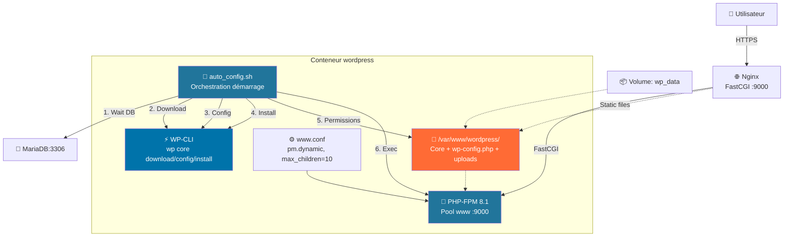
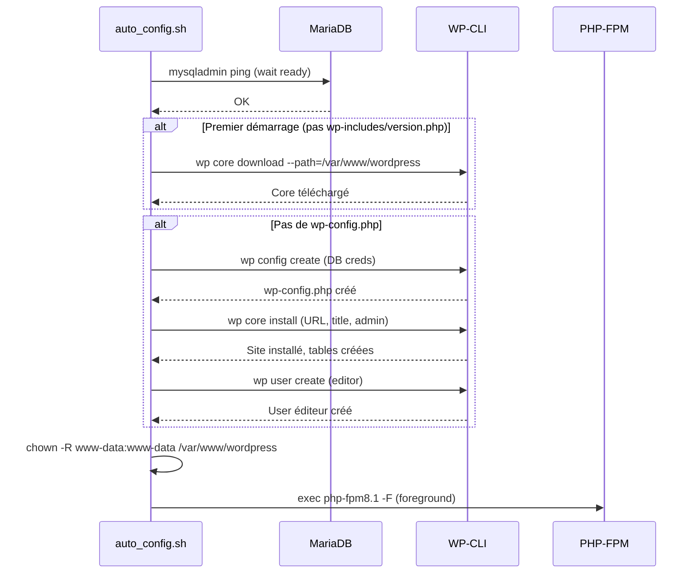

# WordPress - Site Web + Auto-Configuration

[](https://wordpress.org/)
[](https://www.php.net/)
[](https://wp-cli.org/)
[](https://ubuntu.com/)
[](https://www.docker.com/)

> **Conteneur WordPress** basé sur Ubuntu 22.04 + PHP 8.1-FPM, avec auto-configuration complète au démarrage (WP-CLI) : téléchargement core, création `wp-config.php`, installation site, création utilisateurs. Partage le volume `wp_data` avec Nginx pour les assets statiques.

---

## Architecture



### Séquence Auto-Configuration



---

## Configuration

### Variables d'Environnement (via `.env`)

| Variable | Défaut | Description |
|----------|--------|-------------|
| `SQL_DATABASE` | `wordpress` | Nom base de données |
| `SQL_USER` | `wp_user` | User DB |
| `SQL_PASSWORD` | *requis* | Mot de passe DB |
| `WP_URL` | `https://localhost:8443` | URL publique du site |
| `WP_TITLE` | `Mon Site WordPress` | Titre du site |
| `WP_ADMIN_LOGIN` | `admin` | Login administrateur |
| `WP_ADMIN_PASSWORD` | *requis* | Mot de passe admin |
| `WP_ADMIN_EMAIL` | *requis* | Email admin |
| `WP_USER_LOGIN` | `editor` | Login utilisateur éditeur |
| `WP_USER_EMAIL` | *requis* | Email éditeur |
| `WP_USER_PASSWORD` | *requis* | Mot de passe éditeur |

### Fichiers de Configuration

| Fichier | Rôle | Montage |
|---------|------|---------|
| `conf/www.conf` | Pool PHP-FPM `www` (port 9000, pm.dynamic) | `/etc/php/8.1/fpm/pool.d/www.conf` |
| `conf/auto_config.sh` | Script auto-config + démarrage PHP-FPM | `/usr/local/bin/auto_config.sh` |

#### `www.conf` — Pool PHP-FPM

```ini
[www]
user = www-data
group = www-data
listen = 9000                    # Port FastCGI
listen.owner = www-data
listen.group = www-data
pm = dynamic                     # Gestion dynamique processus
pm.max_children = 10             # Max processus simultanés
pm.start_servers = 3             # Au démarrage
pm.min_spare_servers = 2         # Minimum inactifs
pm.max_spare_servers = 5         # Maximum inactifs
clear_env = no                   # Garder variables d'env (pour WP-CLI)
```

#### `auto_config.sh` — Logique Complète

```bash
#!/bin/bash
set -e

# 1. Attendre MariaDB prêt (via credentials WP user)
while ! mysqladmin ping -h mariadb -u "${SQL_USER}" -p"${SQL_PASSWORD}" --silent; do
    sleep 2
done

cd /var/www/wordpress

# 2. Télécharger WordPress core si absent
if [ ! -f wp-includes/version.php ]; then
    echo "Downloading WordPress core..."
    wp core download --allow-root --path=/var/www/wordpress
fi

# 3. Config + Install si pas de wp-config.php
if [ ! -f wp-config.php ]; then
    # wp-config.php
    wp config create --allow-root \
        --dbname="${SQL_DATABASE}" \
        --dbuser="${SQL_USER}" \
        --dbpass="${SQL_PASSWORD}" \
        --dbhost=mariadb:3306 \
        --path=/var/www/wordpress

    # Installation site (tables, options, admin)
    wp core install --allow-root \
        --url="${WP_URL}" \
        --title="${WP_TITLE}" \
        --admin_user="${WP_ADMIN_LOGIN}" \
        --admin_password="${WP_ADMIN_PASSWORD}" \
        --admin_email="${WP_ADMIN_EMAIL}" \
        --path=/var/www/wordpress

    # Utilisateur éditeur additionnel
    wp user create --allow-root "${WP_USER_LOGIN}" "${WP_USER_EMAIL}" \
        --user_pass="${WP_USER_PASSWORD}" \
        --role=editor \
        --path=/var/www/wordpress
fi

# 4. Permissions (critique pour uploads/plugins)
chown -R www-data:www-data /var/www/wordpress

# 5. Démarrer PHP-FPM foreground
exec php-fpm8.1 -F
```

---

## Docker

### Dockerfile — Analyse

```dockerfile
###########################################################
# Dockerfile WordPress - Ubuntu 22.04 + PHP 8.1-fpm
###########################################################
FROM ubuntu:22.04

ENV DEBIAN_FRONTEND=noninteractive

# 1. SYSTEM DEPS + PHP 8.1-fpm + EXTENSIONS WP REQUIS
RUN apt-get update -y && apt-get upgrade -y \
    && apt-get install -y \
    php8.1 php8.1-fpm php8.1-mysql php8.1-curl php8.1-gd \
    php8.1-mbstring php8.1-xml php8.1-zip php8.1-intl \
    mariadb-client wget ca-certificates \
    && apt-get clean && rm -rf /var/lib/apt/lists/*

# 2. WP-CLI (outil CLI officiel WordPress)
RUN wget -O /usr/local/bin/wp https://raw.githubusercontent.com/wp-cli/builds/gh-pages/phar/wp-cli.phar \
    && chmod +x /usr/local/bin/wp

# 3. CONFIG PHP-FPM (pool www)
COPY conf/www.conf /etc/php/8.1/fpm/pool.d/www.conf

# 4. AUTO-CONFIG SCRIPT (le cerveau - templaté par Ansible)
COPY conf/auto_config.sh /usr/local/bin/
RUN chmod +x /usr/local/bin/auto_config.sh

# 5. DOSSIERS RUNTIME
RUN mkdir -p /var/www/wordpress /run/php

EXPOSE 9000
ENTRYPOINT ["/usr/local/bin/auto_config.sh"]
```

### Extensions PHP Installées

| Extension | Usage WordPress |
|-----------|-----------------|
| `php8.1-mysql` | Driver MariaDB/MySQL (mysqli, pdo_mysql) |
| `php8.1-curl` | Requêtes HTTP (API, updates, oEmbed) |
| `php8.1-gd` | Manipulation images (thumbnails, crop) |
| `php8.1-mbstring` | Encodage multi-octets (UTF-8) |
| `php8.1-xml` | XML/RSS/REST API |
| `php8.1-zip` | Installation plugins/thèmes (zip) |
| `php8.1-intl` | Internationalisation (ICU) |

### Build & Run

```bash
# Build seul
docker build -t wordpress-wp:local ./wordpress

# Run standalone (test avec DB externe)
docker run -d --name wp-test \
  -e SQL_DATABASE=wordpress \
  -e SQL_USER=wp_user \
  -e SQL_PASSWORD=wppass \
  -e WP_URL=https://localhost:8443 \
  -e WP_TITLE="Test" \
  -e WP_ADMIN_LOGIN=admin \
  -e WP_ADMIN_PASSWORD=adminpass \
  -e WP_ADMIN_EMAIL=admin@test.com \
  -e WP_USER_LOGIN=editor \
  -e WP_USER_EMAIL=editor@test.com \
  -e WP_USER_PASSWORD=editorpass \
  -v wp_data:/var/www/wordpress \
  -p 9000:9000 \
  wordpress-wp:local

# Via docker-compose (recommandé)
docker compose up -d wordpress
```

---

## Integration docker-compose

```yaml
wordpress:
  container_name: wordpress
  build: ./wordpress
  env_file: .env
  volumes:
    - wp_data:/var/www/wordpress
  networks:
    - inception
  expose:
    - "9000"
  depends_on:
    mariadb:
      condition: service_healthy
  restart: unless-stopped
```

### Dépendances

- **MariaDB** : `depends_on: mariadb (condition: service_healthy)` — Attend DB prête avant auto-config

### Réseau

- Réseau `inception` (bridge)
- FastCGI sur port 9000 → accessible via `wordpress:9000` depuis Nginx
- **Pas de port mapping hôte** — uniquement via Nginx FastCGI

### Volume

- `wp_data` → `/var/www/wordpress` (partagé avec Nginx pour assets statiques)

---

## Integration Nginx (FastCGI)

### Configuration Nginx (extrait)

```nginx
location ~ \.php$ {
    fastcgi_pass wordpress:9000;           # ← Service Docker
    include fastcgi_params;
    fastcgi_param SCRIPT_FILENAME $document_root$fastcgi_script_name;
    fastcgi_param HTTPS on;                # ← Pour wp_is_ssl()
    fastcgi_intercept_errors on;
}
```

### Partage Volume `wp_data`

```yaml
# docker-compose.yml
volumes:
  wp_data:  # Défini au niveau top

services:
  wordpress:
    volumes:
      - wp_data:/var/www/wordpress
  
  nginx:
    volumes:
      - wp_data:/var/www/wordpress  # Même volume !
```

**Résultat** : Nginx sert les fichiers statiques (images, CSS, JS) directement depuis le volume, PHP-FPM traite seulement le `.php`.

---

## Accès WordPress

### URLs d'accès

| Service | URL | Note |
|---------|-----|------|
| **WordPress (front)** | https://localhost:8443 | Page d'accueil |
| **WordPress (admin)** | https://localhost:8443/wp-admin | Interface d'administration |

### Identifiants par défaut (depuis `.env`)

| Service | Utilisateur | Mot de passe |
|---------|-------------|--------------|
| WordPress Admin | `admin` | `WP_ADMIN_PASSWORD` |
| WordPress Editor | `editor` | `WP_USER_PASSWORD` |
| MariaDB Root | `root` | `SQL_ROOT_PASSWORD` |

> **Note** : Les certificats SSL sont auto-signés en développement. Le navigateur affichera un avertissement de sécurité → "Avancé" → "Accepter le risque et continuer".

### Tests rapides (curl)

```bash
# WordPress front
curl -k https://localhost:8443

# WordPress admin
curl -k https://localhost:8443/wp-admin

# Health check WP-CLI
docker compose exec wordpress wp --allow-root --path=/var/www/wordpress core version
```

---

## Commandes Utiles

### Administration WP-CLI

```bash
# Shell dans le conteneur
docker compose exec wordpress bash

# WP-CLI (depuis le conteneur)
docker compose exec wordpress wp --allow-root --path=/var/www/wordpress <command>

# Exemples courants
docker compose exec wordpress wp --allow-root core version
docker compose exec wordpress wp --allow-root plugin list
docker compose exec wordpress wp --allow-root theme list
docker compose exec wordpress wp --allow-root user list
docker compose exec wordpress wp --allow-root option get home
docker compose exec wordpress wp --allow-root db check
docker compose exec wordpress wp --allow-root cache flush
```

### Gestion Plugins/Thèmes

```bash
# Installer plugin
docker compose exec wordpress wp --allow-root plugin install woocommerce --activate

# Mettre à jour tout
docker compose exec wordpress wp --allow-root core update
docker compose exec wordpress wp --allow-root plugin update --all
docker compose exec wordpress wp --allow-root theme update --all

# Rechercher
docker compose exec wordpress wp --allow-root plugin search seo --field=name
```

### Base de Données

```bash
# Export DB
docker compose exec wordpress wp --allow-root db export backup_$(date +%F).sql

# Import DB
docker compose exec wordpress wp --allow-root db import backup_2026-01-15.sql

# Rechercher/remplacer URLs (migration)
docker compose exec wordpress wp --allow-root search-replace 'http://old' 'https://new' --skip-columns=guid
```

### Debug

```bash
# Logs démarrage (auto-config)
docker compose logs wordpress

# Suivi temps réel
docker compose logs -f wordpress

# Logs PHP-FPM
docker compose exec wordpress tail -f /var/log/php8.1-fpm.log  # Si configuré

# Vérifier processus
docker compose exec wordpress ps aux

# Test FastCGI (depuis nginx conteneur)
docker compose exec nginx cgi-fcgi -bind -connect wordpress:9000

# Permissions
docker compose exec wordpress ls -la /var/www/wordpress/
docker compose exec wordpress stat /var/www/wordpress/wp-config.php
```

### Maintenance Mode

```bash
# Activer
docker compose exec wordpress wp --allow-root maintenance-mode activate

# Désactiver
docker compose exec wordpress wp --allow-root maintenance-mode deactivate

# Status
docker compose exec wordpress wp --allow-root maintenance-mode status
```

---

## Securite

### Implemente

- **Non-root** : PHP-FPM workers en `www-data` (uid 33)
- **Secrets externalises** : Via `.env` (gitignored)
- **WP-CLI `--allow-root`** : Necessaire dans conteneur, mais process final en www-data
- **Permissions** : `chown -R www-data:www-data` au demarrage
- **clear_env = no** : Garde variables d'env pour WP-CLI
- **Reseau isole** : Port 9000 non expose sur hote
- **HTTPS force** : `fastcgi_param HTTPS on` + `WP_URL` en https

### Recommandations Prod

```yaml
# docker-compose.override.yml
services:
  wordpress:
    # Sécurité conteneur
    cap_drop: [ALL]
    cap_add: [CHOWN, DAC_OVERRIDE, SETGID, SETUID]
    read_only: true
    tmpfs:
      - /var/www/wordpress/wp-content/uploads
      - /var/www/wordpress/wp-content/cache
      - /run/php
      - /tmp
    security_opt:
      - no-new-privileges:true
    
    # Variables de sécurité WP
    environment:
      - WP_DEBUG=false
      - WP_DEBUG_LOG=false
      - WP_DEBUG_DISPLAY=false
      - DISALLOW_FILE_EDIT=true
      - WP_AUTO_UPDATE_CORE=minor
```

### Durcissement WordPress (via wp-config.php auto-généré)

Le script `auto_config.sh` génère un `wp-config.php` standard. Pour ajouter des constantes de sécurité, modifier le script ou utiliser un mu-plugin :

```php
// Exemple mu-plugin (wp-content/mu-plugins/security.php)
define('DISALLOW_FILE_EDIT', true);
define('DISALLOW_FILE_MODS', false);  // true = bloque updates plugins/themes
define('FORCE_SSL_ADMIN', true);
define('WP_HTTP_BLOCK_EXTERNAL', true);
define('WP_ACCESSIBLE_HOSTS', 'api.wordpress.org,*.github.com');
```

---

## Depannage

| Symptôme | Cause | Solution |
|----------|-------|----------|
| `Error establishing database connection` | Credentials DB wrong | Vérifier `SQL_USER`, `SQL_PASSWORD`, `SQL_DATABASE`, `SQL_HOST` |
| `wp-config.php` déjà existe mais site pas installé | Installation interrompue | Supprimer `wp-config.php` et redémarrer : `docker compose restart wordpress` |
| `Permission denied` sur uploads | UID/GID mismatch | `docker compose exec wordpress chown -R www-data:www-data /var/www/wordpress` |
| `Maximum execution time exceeded` | Script trop long | Augmenter `max_execution_time` dans php.ini ou `.user.ini` |
| `Memory exhausted` | PHP memory_limit trop bas | Ajouter `php_value[memory_limit] = 256M` dans `www.conf` |
| `FastCGI error` / 502 | PHP-FPM pas ready / crash | `docker compose logs wordpress`, vérifier `php-fpm8.1 -F` tourne |
| `WP-CLI command not found` | wp pas installé | Vérifier Dockerfile ligne WP-CLI, rebuild |
| `Table 'wp_options' doesn't exist` | DB vide / pas initialisée | Vérifier MariaDB healthcheck, logs mariadb init.sql |

### Reset Complet (Réinstallation WP)

```bash
# Arrêter
docker compose down wordpress

# Supprimer volume (ATTENTION : PERTE CONTENU : uploads, plugins, themes, DB dans wp_data)
docker volume rm docker_wp_data

# Redémarrer (réinstallation complète)
docker compose up -d --build wordpress
```

> Note : Pour garder uploads/plugins mais reinstaller core : supprimer seulement `wp-config.php` et `wp-includes/` puis restart.

---

## Structure

```
wordpress/
├── Dockerfile
├── conf/
│   ├── www.conf          # Pool PHP-FPM (port 9000, pm.dynamic)
│   └── auto_config.sh    # Auto-config : wait DB, download, config, install, perms, start
└── README.md             # Ce fichier
```

---

## Conventions GitHub

### Commits Spécifiques WordPress

```bash
# PHP-FPM config
git commit -m "perf(wordpress): tune pm.max_children to 20 for high traffic"

# Auto-config
git commit -m "feat(wordpress): add wp language install in auto_config.sh"

# WP-CLI
git commit -m "chore(wordpress): update WP-CLI to latest in Dockerfile"

# Extensions PHP
git commit -m "feat(wordpress): add php8.1-imagick for better image handling"

# Sécurité
git commit -m "security(wordpress): add DISALLOW_FILE_EDIT in auto-generated wp-config"
```

### Labels Issues

- `wordpress` - Core, installation, config
- `php` - PHP-FPM, extensions, performance
- `wp-cli` - Commandes, automatisation
- `database` - Connexion MariaDB, migrations
- `uploads` - Medias, permissions, volume

### PR Checklist WordPress

- [ ] `auto_config.sh` syntaxe bash valide (`shellcheck`)
- [ ] `www.conf` PHP-FPM valide (`php-fpm8.1 -t`)
- [ ] Extensions PHP requises présentes dans Dockerfile
- [ ] Test démarrage propre : `docker compose up -d wordpress` → site accessible
- [ ] Test réinstallation : volume clean → site s'installe auto
- [ ] Permissions `www-data:www-data` sur `/var/www/wordpress`
- [ ] Variables `.env.example` synchronisées

---

## References

| Ressource | Lien |
|-----------|------|
| WordPress Docker Official | https://hub.docker.com/_/wordpress |
| WP-CLI Commands | https://wp-cli.org/commands/ |
| PHP-FPM Configuration | https://www.php.net/manual/en/install.fpm.configuration.php |
| WordPress Requirements | https://wordpress.org/about/requirements/ |
| Hardening WordPress | https://wordpress.org/support/article/hardening-wordpress/ |
| WP-CLI Config | https://make.wordpress.org/cli/handbook/config/ |

---

## Licence

MIT — Voir [LICENSE](../../LICENSE).

*WordPress est sous licence GPL v2+, ce conteneur fournit l'environnement d'exécution.*

---

*Dernière mise à jour : 2026-11-17 — Partie de la stack Docker WordPress.*